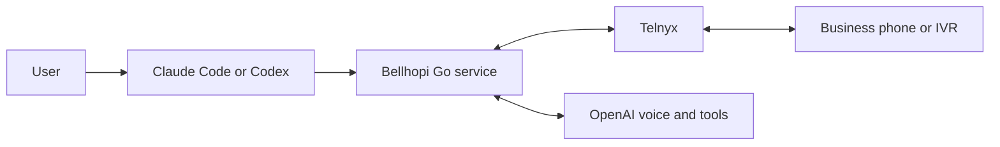

# Bellhopi

Your AI concierge for phone calls. Give Claude Code or Codex a task; Bellhopi calls the business through Telnyx, navigates phone menus with real DTMF keypad tones, and speaks with staff using OpenAI GPT-Live.

> “Call the UPS Store at my selected branch and ask about renting a mailbox. Here is my information and budget.”

Built in Go with [enetx/g](https://github.com/enetx/g). Bring your own Telnyx and OpenAI accounts. Bellhopi installs into both clients as the **`concierge-dialer`** skill; that is also the executable name.

## Quick setup

You need Claude Code or Codex and your Telnyx/OpenAI accounts. The prebuilt packages do not require Go, Git, or `make`.

### 1. Download and install

Download the matching archive from [the latest release](https://github.com/bellhopi/bellhopi/releases/latest) and extract it:

| Platform | Archive suffix |
| --- | --- |
| macOS, Apple Silicon | `darwin_arm64.tar.gz` |
| macOS, Intel | `darwin_amd64.tar.gz` |
| Linux, x64 | `linux_amd64.tar.gz` |
| Linux, ARM64 | `linux_arm64.tar.gz` |
| Windows, x64 | `windows_amd64.zip` |
| Windows, ARM64 | `windows_arm64.zip` |

Each archive contains the executable, skill, license notices, this guide, and `BUILD.json` identifying the version and source commit. The release includes `SHA256SUMS` to verify downloads. Binaries are not signed with Apple Developer ID or Windows Authenticode certificates.

Open a terminal in the extracted folder. On macOS or Linux:

```sh
./bin/concierge-dialer install --target both --source "$PWD/skills/concierge-dialer"
```

On Windows, use PowerShell:

```powershell
.\bin\concierge-dialer.exe install --target both --source "$PWD\skills\concierge-dialer"
```

For subsequent CLI examples, Windows users should replace `./bin/concierge-dialer` with `.\bin\concierge-dialer.exe`.

<details>
<summary>Build from source instead</summary>

Requires Git, [Go 1.27 or newer](https://go.dev/dl/), and `make`. In a macOS/Linux shell:

```sh
git clone https://github.com/bellhopi/bellhopi.git
cd bellhopi
make build
./bin/concierge-dialer install --target both --source "$PWD/skills/concierge-dialer"
```

</details>

Use `--target claude` or `--target codex` to install for just one client. The installer copies the skill and executable into `~/.claude/skills/concierge-dialer/` and/or `~/.agents/skills/concierge-dialer/`. It refuses to overwrite an existing installation.

### 2. Prepare your accounts

- **OpenAI:** create an API key with access to the configured models. The current defaults are `gpt-live-1` for voice and `gpt-6-luna` for delegated tool decisions.
- **Telnyx:** obtain an API key, your Ed25519 public key for webhook verification, and a voice-enabled phone number. Create a Voice API / Call Control application, associate an outbound voice profile, and assign the number to the application. Keep its application/connection ID. Follow the [Telnyx Voice API setup guide](https://developers.telnyx.com/docs/voice/programmable-voice/get-started/index) for the portal steps.

### 3. Save your credentials privately

```sh
./bin/concierge-dialer init
nano "${XDG_CONFIG_HOME:-$HOME/.config}/concierge-dialer/config.json"
```

Use your preferred local editor if you do not use `nano`. Fill these fields in the generated JSON file:

On Windows, run `.\bin\concierge-dialer.exe init`, then open the returned `config_path` in a text editor. The default is `$HOME\.config\concierge-dialer\config.json`. Windows uses private access-control lists rather than Unix `0600` permissions. Keep task and answer files in that initialized directory so they inherit private access.

| Field | What to enter |
| --- | --- |
| `openai_api_key` | Your OpenAI API key |
| `telnyx_api_key` | Your Telnyx API key |
| `telnyx_public_key` | Your base64 Ed25519 public key from Telnyx |
| `telnyx_connection_id` | The Voice API application/connection ID |
| `telnyx_from_number` | Your Telnyx number, including the country code, such as `+12125550123` |
| `public_base_url` | The HTTPS URL from step 4 |

Keep the generated `api_token` and other defaults. `init` creates the file with private permissions (`0600`) and refuses to overwrite it. Store credentials in this file or your secret environment, never in chat or a task prompt. See [advanced configuration](skills/concierge-dialer/references/setup.md) for environment overrides and custom paths.

### 4. Give Telnyx a public HTTPS endpoint

Telnyx must reach the local service for call events and live audio. Use a tunnel that supports WebSockets, or your existing HTTPS reverse proxy.

For an initial test, install [Cloudflare's `cloudflared`](https://developers.cloudflare.com/cloudflare-one/networks/connectors/cloudflare-tunnel/downloads/), then run this in a separate terminal and leave it running:

```sh
cloudflared tunnel --url http://127.0.0.1:8787
```

Copy the printed `https://...trycloudflare.com` URL into `public_base_url`, without a path. In your Telnyx Voice API application, set the webhook URL to that same URL followed by `/webhooks/telnyx`:

```text
https://YOUR-TUNNEL.trycloudflare.com/webhooks/telnyx
```

Bellhopi supplies the media WebSocket URL automatically when it places a call. The tunnel will serve the app once you start it in step 5. Keep callback and media routes accessible to Telnyx; interactive login pages prevent it from connecting. Bellhopi verifies Telnyx signatures itself.

[Quick Tunnels](https://developers.cloudflare.com/tunnel/get-started/quick-tunnels/) are for testing: the hostname changes when the tunnel restarts. Update both `public_base_url` and the Telnyx webhook, then restart Bellhopi after any active call has ended. Use a stable tunnel hostname or reverse proxy for ongoing use.

### 5. Check configuration and start Bellhopi

In another terminal, from the extracted package or repository directory:

```sh
./bin/concierge-dialer doctor
./bin/concierge-dialer serve
```

If `doctor` reports missing or invalid fields, fix them before starting the service. Keep `serve` and the tunnel running throughout calls. `doctor` validates local configuration; it does not contact the providers or place a test call.

Check the local service from another terminal:

```sh
curl --fail http://127.0.0.1:8787/health
```

Expected response: `{"status":"ok"}`. Check the same `/health` path on your public tunnel URL to confirm it reaches the service. This still does not verify call audio.

### 6. Give your agent a task

Open a new Claude Code or Codex session so it can discover the installed skill, then ask:

> Use concierge-dialer to call [business and branch]. Ask about [task]. Use [my information]. My limits are [budget and decisions you can make].

The agent finds the authoritative phone number, resolves missing details, and submits the call. Bellhopi listens to each IVR prompt, sends the appropriate keypad selection, and continues the conversation with staff. When a decision needs your input, your agent relays the question and returns your answer to the call. At the end, it reports the outcome and any confirmation.

Setup commands do not place calls. Your first call should be to a destination you authorize, with a simple task that lets you verify audio, a menu selection, and final hangup.

## How it works



The host agent handles task preparation and progress updates. GPT-Live handles the phone conversation, and its delegated backend can send DTMF, wait, ask you a question, or finish the task. The Go service executes the tools and bridges audio.

- One active call at a time; the default call limit is ten minutes.
- Questions wait up to 90 seconds for an answer through your host agent.
- Private call receipts survive restart and prevent automatic duplicate calls. Uncertain outcomes require reconciliation or hangup.
- The service does not record audio. Transcripts remain in memory; limited call state and outcomes are stored in private local files.

## CLI reference

Commands emit JSON and exit nonzero on errors. To use another configuration file, put `--config /absolute/path/config.json` **before** the command.

```sh
./bin/concierge-dialer call --request /private/path/request.json
./bin/concierge-dialer status --id CALL_ID
./bin/concierge-dialer reply --id CALL_ID --question-id QUESTION_ID --answer-file /private/path/answer.txt
./bin/concierge-dialer dtmf --id CALL_ID --digits '1#' --command-id COMMAND_UUID --duration 250
./bin/concierge-dialer hangup --id CALL_ID
./bin/concierge-dialer reconcile --id CALL_ID
```

Normally the [skill](skills/concierge-dialer/SKILL.md) prepares the request and runs these commands. Request files contain string fields `id`, `to`, `task`, and `information`; request and answer files must have private permissions (`0600` on Unix or a private Windows access-control list). Keep one stable call ID for each task, and reuse a manual DTMF command ID only when checking/retrying that exact action. Never create a new ID to bypass an unknown outcome.

## Troubleshooting

| Problem | Next step |
| --- | --- |
| Skill does not appear | Open a new client session and confirm you installed for that client. |
| Installer says the destination exists | Preserve the existing skill folder before replacing it; installation never overwrites it. |
| `doctor` lists missing fields | Edit the private config, save valid JSON, and run `doctor` again. |
| Public `/health` does not respond | Confirm both the tunnel and service are running and the tunnel points to port 8787. |
| Call is `uncertain` or `recovery_required` | Run `status`, then `reconcile` or `hangup` with the same ID. Keep the receipt; do not automatically redial. |

For signatures, private state, and recovery details, see [setup and operation](skills/concierge-dialer/references/setup.md).

## Development and verification

```sh
make test
make check
make build
```

In a source checkout, `test` runs the Go tests and `check` runs the race detector and `go vet`. Tests use local fake providers and temporary client installations. The [verification record](https://github.com/bellhopi/bellhopi/blob/main/docs/verification.md) distinguishes those checks from real Telnyx/GPT-Live audio, IVR acceptance, and business outcomes, which still need a configured live call.

[GitHub Actions](https://github.com/bellhopi/bellhopi/actions/workflows/release.yml) tests and packages all six targets on standard hosted runners. Those runners are [free for public repositories](https://docs.github.com/en/billing/concepts/product-billing/github-actions). A `vMAJOR.MINOR.PATCH` tag publishes the archives and checksums only after every native test and installation smoke check passes. Pushes and pull requests build development artifacts without creating a release.

Claude Code commit, pull-request, and session-link attribution are disabled for this repository in [.claude/settings.json](https://github.com/bellhopi/bellhopi/blob/main/.claude/settings.json), using its [documented attribution settings](https://code.claude.com/docs/en/settings-reference#attribution).

## License

[MIT](LICENSE). Copyright (c) 2026 bsd and Bellhopi contributors.
